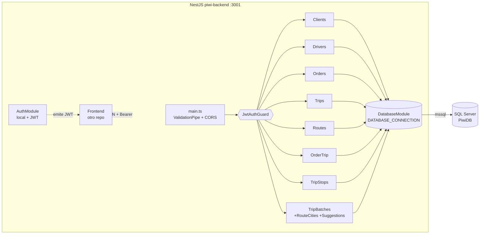
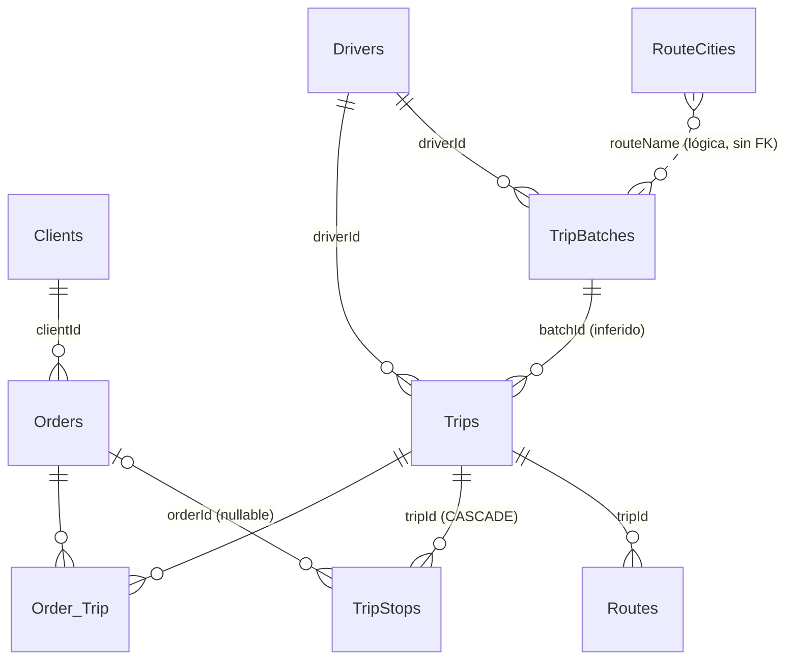
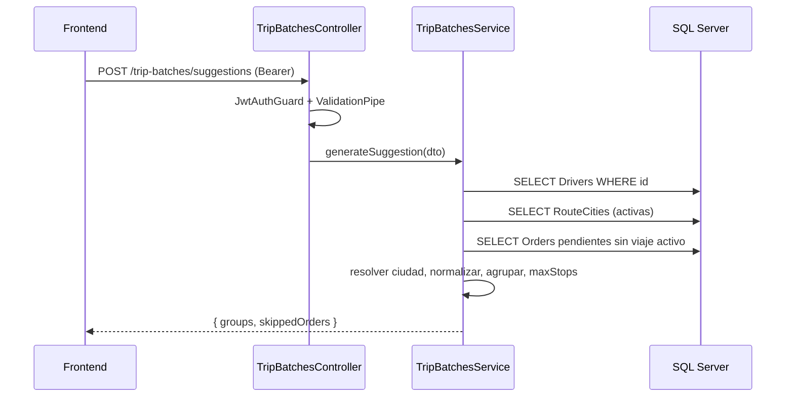
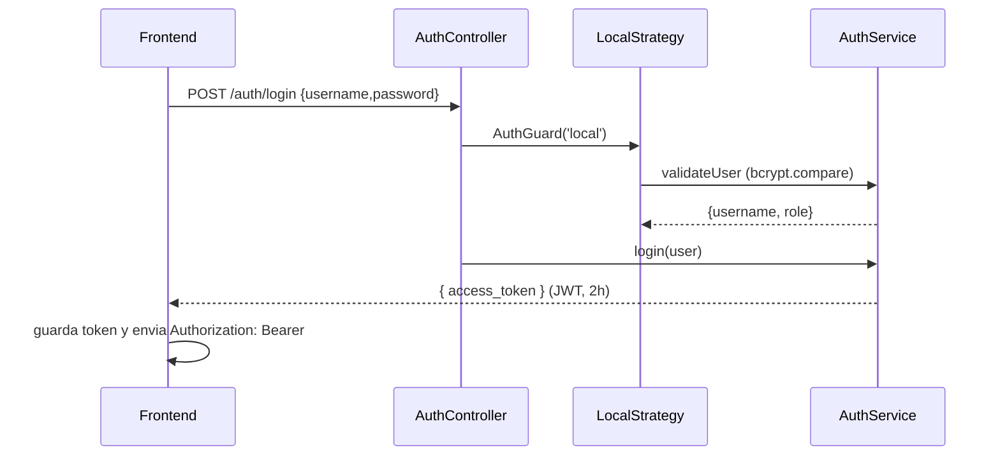

# PiwiSystem — Diagnóstico técnico del BACKEND

> Generado por análisis de solo lectura del directorio `piwi-backend` (rama `feature/block-parada-orderid`, HEAD `339759e` + cambios sin commitear).
> Convención: **[C]** = confirmado en el código (con ruta); **[I]** = inferido; lo no resuelto está en la sección 14.
> Alcance: solo backend. El frontend no fue inspeccionado.

---

## 1. Resumen general

- **Qué hace [C/I]**: API para logística de encomiendas y planificación de rutas. Flujo del CLAUDE.md: clientes crean órdenes → órdenes se asignan a viajes → viajes tienen paradas (`TripStops`) → rutas guardan GeoJSON/PDF → se asigna conductor. Sobre eso, los commits recientes agregan el concepto de **"Salida" (`TripBatches`)**: una salida agrupa varias hojas de ruta (`Trips`) por ciudad a lo largo de una ruta fija (default "Ceres - Santa Fe"), con sentido `ida`/`vuelta`, y un endpoint de **sugerencias** que agrupa encomiendas pendientes por ciudad (`src/trip-batches/trip-batches.service.ts`).
- **Para quién [I]**: operadores de una empresa de encomiendas/transporte regional (Santa Fe, Argentina; mensajes y estados en español). Hay un único rol `admin`.
- **Tipo [C]**: **API REST monolítica** NestJS, un solo proceso, sin colas, workers, jobs ni GraphQL (`src/app.module.ts`, no hay `@Cron`/`@Process`).

## 2. Stack tecnológico

| Aspecto | Detalle | Fuente |
|---|---|---|
| Lenguaje | TypeScript 5.8.3 (instalado), target ES2023, CommonJS, `strictNullChecks` activo pero `noImplicitAny: false` | `tsconfig.json` |
| Framework | NestJS 11.1.3 (`@nestjs/common/core/platform-express`), Express 5 | `package.json` |
| Base de datos | Microsoft SQL Server, driver `mssql` 11.0.1, **sin ORM**, SQL parametrizado a mano | `src/database/database.providers.ts` |
| Auth | `@nestjs/passport`, `passport-local`, `passport-jwt`, `@nestjs/jwt`, `bcrypt` | `src/auth/*` |
| Validación | `class-validator` 0.14.2 + `class-transformer`, `@nestjs/mapped-types` (`PartialType`) | DTOs |
| Config | `@nestjs/config` (`ConfigModule.forRoot({ isGlobal: true })`) | `src/app.module.ts` |
| Tests | Jest 29 + ts-jest, supertest | `package.json` |
| Lint/format | ESLint 9 (typescript-eslint `recommendedTypeChecked`) + Prettier (`singleQuote`, `trailingComma: all`) | `eslint.config.mjs`, `.prettierrc` |
| Build | `nest build` → `dist/` (`deleteOutDir: true`) | `nest-cli.json` |
| Contenedores / CI/CD | **No existen** (no hay Dockerfile, ni `.github`, ni pipeline) | `git ls-files` |

**Dependencias declaradas pero sin uso [C]**: `typeorm` y `@nestjs/typeorm` están en `package.json`, pero `grep typeorm src` no devuelve nada. Se usa `mssql` directo.

## 3. Arquitectura

### 3.1 Patrón y estructura

Monolito modular NestJS, de **tres capas simples por feature**: `controller → service → SQL`. No hay capa de repositorio; los services ejecutan SQL directamente sobre el `ConnectionPool`.

```
src/
├── main.ts                 # bootstrap, ValidationPipe global, CORS
├── app.module.ts           # importa todos los módulos + ConfigModule global
├── database/               # provider 'DATABASE_CONNECTION' (mssql.ConnectionPool)
├── auth/                   # login local + JWT, usuarios hardcodeados
├── health/                 # GET /health (público)
├── clients/ drivers/ orders/ trips/ routes/ order-trip/ trip-stops/
└── trip-batches/           # salidas + route-cities + sugerencias (+ spec)
    ├── dto/  interfaces/
sql/                        # scripts SQL manuales (solo 2)
test/                       # e2e (plantilla sin adaptar)
```

Cada feature: `[f].module.ts`, `[f].service.ts`, `[f].controller.ts`, interfaz del entity y `dto/create-*.dto.ts` / `update-*.dto.ts` (`PartialType`). `trip-batches` usa además `interfaces/` (varias) y no `[f].interface.ts` [C].

### 3.2 Módulos y relación

Los módulos **no se importan entre sí** (solo `DatabaseModule`); las relaciones entre entidades viven en FKs de SQL [C: todos los `*.module.ts`]. `AuthModule` es independiente, y los controladores importan `JwtAuthGuard` directamente de `src/auth/jwt-auth.guard.ts`.

### 3.3 DI, middlewares, pipeline

- DI: token string `'DATABASE_CONNECTION'` → `ConnectionPool` creado en un `useFactory` async. Se inyecta con `@Inject('DATABASE_CONNECTION')` [C].
- `DatabaseModule` se importa en cada módulo; como los providers son por módulo, **cada módulo que lo importa comparte la misma instancia** (módulos de Nest son singleton) pero `sql.connect()` se usa como pool global de `mssql` [I].
- Pipeline: request → CORS → `ValidationPipe` global (`whitelist: true`, `transform: true`, **sin** `forbidNonWhitelisted`) → `JwtAuthGuard` (por controlador) → `ParseIntPipe` en params → controller → service → SQL. **No hay** interceptors, filtros de excepción globales ni middlewares propios [C].

### 3.4 Diagrama de componentes



## 4. Modelo de datos

**Fuente de verdad [C]**: `sql/000_baseline.sql` (snapshot de la base real, 2026-10-12). Si algo de esta sección contradice ese archivo, manda el baseline. La tabla de abajo resume el baseline; `001_*` y `002_*` ya están incluidos en él.

**`TripStops.name` [C]**: el baseline no la tiene, pero el frontend la envía y la muestra (`RouteStop.name`). Se resolvió con `sql/003_tripstops_name.sql` (`NVARCHAR(150) NULL`, idempotente), que **debe aplicarse sobre el baseline** antes de usar `POST /trip-stops` o `POST /trip-batches/confirm` (este último inserta `name` = nombre del contacto o `Encomienda #<id>`).

### 4.1 Entidades

| Tabla | Campos principales | Restricciones | Fuente |
|---|---|---|---|
| `Clients` | id, name, address, phone, email | — (no hay DDL en repo) | `clients.service.ts` |
| `Orders` | id, clientId, origin, destination, **originCity, destinationCity** (solo leídas), weight, volume, status, createdAt, originAddress, destinationAddress, senderName/Phone, recipientName/Phone, amountToCollect DECIMAL(10,2), notes | status: `pendiente` / `en tránsito` / `entregado` (enum del DTO) | `orders.service.ts`, `trip-batches.service.ts`, sql/001 |
| `Drivers` | id, name, phone, licenseNumber, truckPlate, notes, isActive, createdAt | `UX_Drivers_licenseNumber` único | sql/001, sql/002 |
| `Trips` ("hojas de ruta") | id, tripDate (date), departureTime (datetime2), driverId, origin, destination, status, notes, createdAt, **batchId, routeOrder, sheetCity** (solo leídas), legacy `vehicle`/`driver` siempre NULL | CHECK `chk_trip_status` (scheduled/in_transit/delivered/canceled); FK `FK_Trips_Drivers` | sql/001, `trips.service.ts` |
| `Order_Trip` | orderId, tripId | PK/UNIQUE inferido (el código maneja errores 2627/2601); FKs inferidas (547) | `order-trip.service.ts` |
| `TripStops` | id, tripId, orderId NULL, sequence, name, stopType, city, address, contactName/Phone, scheduledTime NVARCHAR(20), notes, cashOnDelivery BIT, cashAmount, completed BIT, createdAt | UNIQUE (tripId, sequence); CHECK stopType IN (pickup, delivery, checkpoint, other); FK→Trips `ON DELETE CASCADE`; FK→Orders | sql/001 |
| `Routes` | id, tripId, routeGeoJson, pdfUrl, generatedAt | sin DDL en repo | `routes.service.ts` |
| `TripBatches` ("salidas") | id, tripDate, routeName, originCity, finalDestinationCity, direction, status, driverId, notes, createdAt, updatedAt | sin DDL en repo; FK a Drivers inferida (el código mapea error 547) | `trip-batches.service.ts` |
| `RouteCities` | id, routeName, cityName, sequence, isActive, createdAt | unicidad (routeName, cityName) y (routeName, sequence) **solo validada en el service entre activas**, no se sabe si hay índice | `trip-batches.service.ts:276-330` |

### 4.2 Diagrama ER (según lo observable)



### 4.3 Enums y estados

- `Orders.status`: `pendiente | en tránsito | entregado` (`src/orders/dto/create-order.dto.ts`).
- `Trips.status`: `scheduled | in_transit | delivered | canceled` (DTO + CHECK en SQL).
- `TripBatches.status`: `draft | confirmed | in_transit | completed | canceled` (`create-trip-batch.dto.ts`); **no sabemos si hay CHECK en DB**.
- `TripBatches.direction`: `ida | vuelta`.
- `TripStops.stopType`: `pickup | delivery | checkpoint | other`.
- Stored procedures / vistas / triggers: **no hay ninguno** en el repo.

### 4.4 Migraciones

Manuales, ejecutados a mano en SSMS. `sql/000_baseline.sql` es un snapshot **no idempotente** (solo para bases vacías); `001_*` y `002_*` son idempotentes pero ya están incluidos en el baseline; todo cambio nuevo va en `sql/00N_*.sql` idempotente. No hay herramienta de migraciones [C].

## 5. API

Base: `http://localhost:3001` (puerto de `PORT`, default 3001). Sin prefijo global ni versionado. **Todos** los controladores usan `@UseGuards(JwtAuthGuard)` salvo `auth/login` y `health` [C].

| Método | Ruta | Propósito | Auth | Request → Response |
|---|---|---|---|---|
| POST | `/auth/login` | Login (`username`, `password`) | no (LocalStrategy) | → `{ access_token }` |
| GET | `/auth/me` | Datos del token | JWT | → `{ username, role }` |
| GET | `/health` | Healthcheck | no | → `{ status: 'ok' }` |
| GET/POST | `/clients` | Listar / crear | JWT | POST `{name,address?,phone?,email}` → `{id}` |
| GET/PUT/DELETE | `/clients/:id` | Detalle / actualizar / borrar | JWT | PUT parcial → `void` |
| GET/POST | `/drivers` | Listar / crear | JWT | `{name,licenseNumber,phone?,truckPlate?,notes?,isActive?}` → `{id}` |
| GET/PUT/DELETE | `/drivers/:id` | CRUD | JWT | |
| GET/POST | `/orders` | Listar / crear. **Siempre nace `pendiente`** (un `status` recibido se descarta) | JWT | ver 5.3 → `{id}` |
| GET/PUT/DELETE | `/orders/:id` | CRUD. En PUT, `status` solo cambia a mano entre `pendiente` y `cancelado` (400 si no); repetir el estado actual es válido | JWT | |
| GET/POST | `/trips` | Listar / crear | JWT | `{date,driverId?,origin,destination,status,notes?}` → `{id}` |
| GET/PUT/DELETE | `/trips/:id` | CRUD; PUT devuelve el string `"Actualizado"` | JWT | |
| GET/POST | `/routes` | Rutas (GeoJSON/PDF) | JWT | `{tripId,routeGeoJson,pdfUrl?}` → `{id}` |
| GET/PUT/DELETE | `/routes/:id` | CRUD | JWT | |
| GET | `/order-trip` | Junction (**solo lectura**; POST y DELETE se eliminaron: las asignaciones las hace el confirm) | JWT | |
| GET | `/order-trip/order/:orderId`, `/order-trip/trip/:tripId` | Filtros | JWT | |
| GET/POST | `/trip-stops` | Paradas | JWT | POST con `orderId` → **400** (ver 6.3) |
| GET | `/trip-stops/trip/:tripId` | Paradas de un viaje | JWT | |
| GET/PUT/DELETE | `/trip-stops/:id` | CRUD; PUT con `orderId` → 400. PUT `completed: true` en una parada `delivery` con orden `en tránsito` la pasa a `entregado` | JWT | |
| GET/POST | `/trip-batches` | Salidas (GET incluye `driverName`, `truckPlate`). **POST siempre crea en `draft`** (`status` se descarta) | JWT | POST `{tripDate,originCity,finalDestinationCity,direction,driverId,routeName?,notes?}` → `TripBatch` |
| GET/PUT/DELETE | `/trip-batches/:id` | Detalle / actualizar / borrar (400 si tiene Trips). **PUT ya no cambia `status`** (se ignora; usar PATCH) | JWT | |
| GET | `/trip-batches/:id/trips` | Trips de la salida | JWT | |
| GET/POST | `/trip-batches/route-cities` | Ciudades de ruta activas (`?routeName=`) | JWT | POST `{cityName,sequence,routeName?}` |
| PUT/DELETE | `/trip-batches/route-cities/:id` | Actualizar / baja lógica (`isActive=0`) | JWT | |
| POST | `/trip-batches/suggestions` | Sugerencia de grupos por ciudad | JWT | ver 6.2 |
| POST | `/trip-batches/confirm` | Confirma una sugerencia (transacción única) | JWT | ver 5.1 |
| PATCH | `/trip-batches/:id/status` | Transición de estado de la salida con propagación | JWT | ver 5.2 |

### 5.1 `POST /trip-batches/confirm`

- **Request** (el que arma `buildConfirmPayloadFromSuggestion` del frontend):
  `{ tripDate, routeName?, direction: 'ida'|'vuelta', originCity, finalDestinationCity, driverId, notes?, groups: [{ city, routeOrder, stops: [{ orderId, sequence, stopType, city, address?, contactName?, contactPhone?, cashOnDelivery, cashAmount, notes? }] }] }`. Cada grupo y cada lista de paradas deben tener al menos un elemento.
- **Response 201**: `{ id, tripDate, routeName, direction, originCity, finalDestinationCity, status: 'confirmed', driverId, groupsCreated, ordersAssigned, trips: [{ id, batchId, sheetCity, routeOrder, stopsCreated }] }`.
- **Errores**: `400` validación del DTO (`message` es `string[]`), conductor inexistente, órdenes inexistentes, órdenes repetidas, ciudades de grupo repetidas; `409` con `{ statusCode: 409, message: string, error: 'Conflict', orderIds: number[] }` si alguna orden ya no está `pendiente` o ya tiene un viaje no cancelado (también `409` ante violación de índice único). En todo error se hace rollback completo.

### 5.3 `/orders`

- **`POST /orders`** — body: `clientId` (int), `origin` (≤200), `destination` (≤200), `weight` (número), `volume?` (número) y opcionales `originCity`, `destinationCity` (≤100), `originAddress`, `destinationAddress` (≤300), `senderName`, `recipientName` (≤150), `senderPhone`, `recipientPhone` (≤50), `amountToCollect` (≥0), `notes` (≤500). `status` no existe en el alta: se descarta. → **201** `{ id }`.
- **`PUT /orders/:id`** — mismos campos, todos opcionales, más `status?`. `status` solo puede pasar entre `pendiente` y `cancelado` (o repetir el actual); otro cambio → **400**. Orden inexistente al cambiar `status` → **404**. Body vacío → no hace nada. → `200` sin cuerpo.
- **`GET /orders`, `GET /orders/:id`** — devuelven la fila completa de `Orders`: `id, clientId, origin, destination, originCity, destinationCity, weight, volume, status, createdAt, originAddress, destinationAddress, senderName, senderPhone, recipientName, recipientPhone, amountToCollect, notes` (`status`: `pendiente|asignada|en tránsito|entregado|cancelado`).

### 5.2 `PATCH /trip-batches/:id/status`

- **Request**: `{ status: 'draft'|'confirmed'|'in_transit'|'completed'|'canceled' }`.
- **Response 200**: el `TripBatch` actualizado (misma forma que `GET /trip-batches/:id`).
- **Errores**: `404` salida inexistente; `400` transición no permitida (`No se puede pasar la salida de "X" a "Y"`) o `status` fuera del enum.

**Errores [C]**: formato estándar de Nest (`{ statusCode, message, error }`); mensajes en español para not found/validación de negocio y algunos en inglés (ej. `Client with id X not found`). El `ValidationPipe` devuelve `message` como **array** de strings.
**Jobs/colas/eventos**: ninguno.
**Paginación**: no existe; todos los `GET` de lista devuelven todo [C].

## 6. Flujos y reglas de negocio

Las reglas viven **en los services** (no hay capa de dominio). Las únicas reglas relevantes están en `trip-batches.service.ts` y en los CHECK/UNIQUE de SQL.

### 6.1 CRUD de salida
`POST /trip-batches` → DTO valida → `assertDriverExists` (400 si no existe) → INSERT con `status` default `draft`, `routeName` default `Ceres - Santa Fe`, `tripDate` recortado a `YYYY-MM-DD` → devuelve la fila. `DELETE` rechaza (400) si existen `Trips.batchId = id`. `PUT` ya no acepta cambios de `status` (el DTO lo omite; con `whitelist` se descarta en silencio).

`POST /trip-batches` siempre crea en `draft`: `CreateTripBatchDto` ya no tiene `status`.

### 6.2 Sugerencias — `POST /trip-batches/suggestions` (el flujo más complejo)
Entrada: `tripDate, direction, driverId, [routeName, originCity, finalDestinationCity, maxStopsPerCity]`.
1. Verifica que el conductor exista.
2. Defaults: ida → origen `Ceres`, destino final `Santa Fe`; vuelta al revés.
3. Lee `RouteCities` activas de la ruta (orden `sequence`); en `vuelta` se invierte el orden.
4. Lee candidatas: `Orders.status = 'pendiente'` y que **no** estén en `Order_Trip` junto a un Trip con `status <> 'canceled'`.
5. Por encomienda: ciudad = `destinationCity`/`destination` (ida) o `originCity`/`origin` (vuelta), tomando el texto **antes de la primera coma**, con fallback si el campo está vacío; normaliza (sin acentos, minúsculas, espacios colapsados).
6. Match exacto contra RouteCities; si no, match por palabras completas solo si da una única ciudad; si da varias → `ambiguous_city`.
7. Se descarta si la ciudad resuelta coincide con la ciudad de origen del viaje (`is_origin_city`).
8. Agrupa por ciudad en el orden de la ruta, ordena por `createdAt` ASC, aplica `maxStopsPerCity` (recorta, sin informar lo recortado), y arma paradas (`delivery` en ida / `pickup` en vuelta, `cashOnDelivery = amountToCollect > 0`).
9. Responde `{ tripDate, routeName, direction, originCity, finalDestinationCity, driverId, groups[], skippedOrders[] }`. **No persiste nada** [C].

### 6.3 Paradas y asignación de órdenes
`POST/PUT /trip-stops` con `orderId` devuelve 400 ("La asignación manual … Usá el flujo de Salidas por ciudad"). La asignación de órdenes a hojas ocurre solo en `POST /trip-batches/confirm`. `/order-trip` es de solo lectura (GET): vincular/desvincular órdenes solo ocurre dentro de `confirm` [C].

### 6.4 Ciclo de vida (confirmación y estados) — implementado
Todo el ciclo vive en `trip-batches.service.ts` (`confirm`, `updateStatus`), `orders.service.ts` (cambio manual) y `trip-stops.service.ts` (completar parada). Cada operación multi-tabla usa `pool.transaction()` (mssql) con commit/rollback.

| Evento | TripBatches.status | Trips.status | Orders.status |
|---|---|---|---|
| Confirmar sugerencia (`POST /trip-batches/confirm`) | `confirmed` | `scheduled` | `pendiente` → `asignada` |
| Iniciar (`PATCH …/status` = `in_transit`) | `in_transit` | `in_transit` | `asignada` → `en tránsito` |
| Completar parada `delivery` con `orderId` (`PUT /trip-stops/:id`) | — | — | `en tránsito` → `entregado` |
| Completar (`PATCH` = `completed`) | `completed` | `delivered` | las `en tránsito` → `entregado` |
| Cancelar (`PATCH` = `canceled`) | `canceled` | `canceled` | `asignada`/`en tránsito` → `pendiente` |
| Cancelar orden (`PUT /orders/:id`) | — | — | `pendiente` ↔ `cancelado` (manual) |

Transiciones de salida: `draft→confirmed`, `confirmed→in_transit`, `in_transit→completed`, y `draft|confirmed|in_transit→canceled`. Cualquier otra → 400. Al cancelar **no** se borran `Order_Trip` ni `TripStops` (historial); la elegibilidad de sugerencias ya ignora viajes `canceled`.

**Detalle de `confirm`** (una transacción): valida duplicados (órdenes y ciudades) antes de abrirla → verifica el conductor → `SELECT … FROM Orders WITH (UPDLOCK, ROWLOCK)` y exige `status='pendiente'` y sin viaje no cancelado (409 con `orderIds` si no) → inserta `TripBatches` (`confirmed`) → por cada grupo, en orden recibido, inserta `Trips` (`batchId`, `routeOrder` = 1..N, `sheetCity`, `scheduled`; en **ida** `origin = originCity` y `destination = ciudad`; en **vuelta** `origin = ciudad` y `destination = finalDestinationCity`), sus `TripStops` (`sequence` = 1..N por hoja, sin columna `name`) y `Order_Trip` → `UPDATE Orders … asignada` verificando que se afecten todas. `routeOrder` y `sequence` se recalculan en el servidor por posición; los valores del payload se ignoran.

### 6.5 Diagramas de secuencia





## 7. Seguridad

- **Autenticación [C]**: JWT HS256 (secret `JWT_SECRET`), expira 2 h, sin refresh token. `JwtStrategy` aborta el arranque si falta el secret (`jwt.strategy.ts`).
- **Usuarios [C]**: un único usuario **hardcodeado en código** `admin@demo.com` / `adm_123` (hash bcrypt calculado al cargar el módulo) en `src/auth/auth.service.ts`. No hay tabla de usuarios. Es una credencial conocida pública en el repo.
- **Autorización [C]**: solo autenticación. El `role` va en el token pero **ningún guard lo verifica** (sin `@Roles`, sin RolesGuard).
- **Rutas públicas**: `/auth/login`, `/health`. No hay guard global; cada controlador nuevo debe aplicar `@UseGuards(JwtAuthGuard)` a mano, de lo contrario queda público.
- **CORS [C]**: orígenes de `CORS_ORIGIN` (coma) o default `localhost:3000` / `127.0.0.1:3000`. Sin `credentials`.
- **Secretos**: `.env` está en `.gitignore` y no está trackeado. `.env.example` sin valores. `JWT_SECRET` en el `.env` local se define con espacio antes del `=` (`JWT_SECRET =...`); `dotenv` lo tolera [I].
- **SQL injection**: valores siempre parametrizados. Riesgo **menor pero real** en los UPDATE dinámicos de `clients`, `drivers`, `trip-stops`, `orders`, `routes`: los **nombres de columna** vienen de `Object.keys(dto)`. Con `whitelist: true` solo pasan propiedades declaradas, así que hoy está acotado [I], pero depende de que ese pipe siga activo.
- Sin rate limiting, helmet, ni bloqueo de intentos de login.

## 8. Integraciones externas

Ninguna [C]: sin correo, storage, colas ni APIs de terceros. `Routes.pdfUrl` y `routeGeoJson` se guardan como texto; nada genera PDFs ni GeoJSON en el backend.

## 9. Configuración y entorno

Variables (`.env.example`):

| Variable | Uso | Default en código |
|---|---|---|
| `PORT` | puerto | `3001` |
| `CORS_ORIGIN` | orígenes CSV | `http://localhost:3000,http://127.0.0.1:3000` |
| `JWT_SECRET` | firma JWT | **obligatoria** (error al arrancar) |
| `DB_HOST` | servidor | `RODRIGO-PC` |
| `DB_INSTANCE_NAME` | instancia con nombre | `SQLEXPRESS02` |
| `DB_PORT` | puerto TCP opcional | — |
| `DB_USER`, `DB_PASSWORD` | credenciales SQL | **obligatorias** |
| `DB_NAME` | base | `PiwiDB` |
| `DB_ENCRYPT` | cifrado | `false` |
| `DB_TRUST_SERVER_CERTIFICATE` | confiar en cert. | `true` salvo `'false'` |

> Ojo: si `DB_INSTANCE_NAME` queda vacío en el `.env`, `??` **no** aplica el default porque `''` no es nullish, y se usa `host` solo; los defaults de `RODRIGO-PC`/`SQLEXPRESS02` solo rigen si la variable no está definida. El `CLAUDE.md` dice que la conexión está hardcodeada: ya **no** es así, está desactualizado.

**Levantar en local**: 1) tener SQL Server con la base `PiwiDB` y las tablas (los scripts de `sql/` son insuficientes, ver 4); 2) `npm install`; 3) copiar `.env.example` a `.env` y completar `JWT_SECRET`, `DB_USER`, `DB_PASSWORD` (y `DB_HOST`/`DB_INSTANCE_NAME`/`DB_PORT`); 4) `npm run start:dev` (puerto 3001); 5) probar `GET /health` y `POST /auth/login`.
**Tests**: `npm test` (unit, `rootDir: src`, `*.spec.ts`); `npm run test:e2e` (ver 11, está roto).
**Deploy**: no hay documentación ni artefactos. `npm run build` + `npm run start:prod` (`node dist/main`). El `README.md` es la plantilla de Nest y su sección "Deployment" no es específica del proyecto.

## 10. Convenciones del código

- **Nombres**: carpetas en kebab-case plural (`trip-stops`), clases `XxxService/Controller/Module`, DTOs `CreateXxxDto`/`UpdateXxxDto = PartialType(Create…)`. Interfaces de entidad en archivo aparte (`xxx.interface.ts`; nombres inconsistentes: `clients.interface.ts`, `order.interface.ts`, `trip.interface.ts`).
- **Controladores**: `@UseGuards(JwtAuthGuard)` a nivel de clase; `ParseIntPipe` en `:id`; el `getOne` lanza `NotFoundException` si el service devuelve `null`; `create` devuelve `{ id }`; `update`/`delete` devuelven `void`.
- **Services**: `@Inject('DATABASE_CONNECTION') pool: ConnectionPool`; SQL en template strings con `.input(name, value)`; `OUTPUT INSERTED.id` en los INSERT; UPDATE dinámico armado con las claves presentes (en `trips` y `trip-batches` con lista explícita de campos, más seguro).
- **Errores**: excepciones de Nest, mapeo de errores SQL por número (547 FK, 2627/2601 único). `trip-batches` es el módulo más cuidado (valida y da mensajes en español); los módulos viejos casi no manejan errores.
- **Logging**: `Logger` de Nest en algunos services, más `console.log` sueltos (`clients.controller.ts`, `database.providers.ts`). Sin logging estructurado ni de requests.
- **Formato JSON**: campos en camelCase, igual que las columnas SQL. Fechas como las devuelve `mssql` (ISO string UTC).
- **Al agregar código nuevo**: seguir el patrón de `trip-batches` (validar existencia, traducir errores SQL, DTO con `class-validator`, `@UseGuards(JwtAuthGuard)`), y escribir en español los mensajes al usuario.
- **Imports**: algunos módulos importan `DatabaseModule` con ruta absoluta `src/database/database.module` (funciona por `baseUrl`/Nest CLI), otros con ruta relativa. Preferir relativa.

## 11. Estado y calidad

**Tests [C]**: un solo spec unitario real, `src/trip-batches/trip-batches.service.spec.ts` (15 casos de `generateSuggestion`, con pool simulado; los de elegibilidad solo verifican el texto del SQL). `test/app.e2e-spec.ts` es la plantilla de Nest: espera `GET / → 'Hello World!'`, que no existe, y además importa `AppModule` completo (requiere SQL Server real). **Cobertura estimada: muy baja (solo la lógica de sugerencias)**. Nunca corrí `test:cov`.

**Deuda técnica / inconsistencias**
- `CreateOrderDto`/`Order` **no incluyen `originCity`/`destinationCity`**, aunque las sugerencias dependen de ellas. Con `whitelist: true`, enviarlas por la API las descarta [C]. Si esas columnas existen en la DB, hoy solo pueden cargarse a mano o por otro canal; si no existen, la consulta de candidatas fallaría. Es el hallazgo más relevante para la funcionalidad de sugerencias.
- `Orders.update` y `Routes.update` con body vacío generan `SET  WHERE` → error SQL 500; `clients`/`drivers`/`trip-stops` sí retornan temprano. `trips` y `trip-batches` manejan bien el caso.
- `PUT /orders/:id`, `/routes/:id`, `/trips/:id`: no verifican si la fila existe (devuelven éxito igual). `DELETE` en todos los módulos tampoco devuelve 404 y varios no traducen errores FK (500 al borrar un cliente con órdenes).
- `Orders.status` y `TripBatches.status` sin transiciones: cualquier valor del enum se puede setear en cualquier momento; nada sincroniza estado de órdenes con estado de viajes.
- Sin paginación ni filtros; `SELECT *` en varios services.
- `UpdateRouteCityDto` permite reactivar con `isActive`, pero `assertNoDuplicate*` solo se ejecuta si cambian nombre/orden: reactivar una ciudad puede duplicar nombre/secuencia [I].
- `TripBatchesService.remove` y `RouteCities` sin transacciones; el flujo de varios pasos no es atómico (no hay `transaction()` en ningún service).
- `CLAUDE.md` desactualizado: dice que la conexión DB está hardcodeada y que el usuario es `admin` (en realidad `admin@demo.com`), y la memoria interna lista `/health` como público (correcto).
- `dist/` presente y `tsconfig.build.tsbuildinfo`; `dist` está ignorado por git.
- `README.md` es la plantilla de Nest.
- `strict` no activo (`noImplicitAny: false`); `eslint` falla hoy en ~15 puntos `no-unsafe-*` por el uso de `recordset` tipado `any` (preexistente).

**Dependencias / seguridad**: `npm audit --omit=dev` reporta **26 vulnerabilidades (2 críticas, 11 altas)**. Críticas transitivas: `proxy-addr`, `sha.js`. Altas directas: `@nestjs/core`, `@nestjs/platform-express`, `typeorm` (este último ni se usa; se puede eliminar junto con `@nestjs/typeorm`). Hay actualizaciones menores disponibles de Nest (11.1.3 → 11.2.7), `mssql` (11.0.1 → 11.0.2), etc. No evalué si cada advisory es explotable en este uso.

## 12. Guía para hacer cambios

**Nueva entidad (CRUD)**
1. Escribir el script `sql/00N_*.sql` idempotente (tabla, FKs, CHECK/UNIQUE) y ejecutarlo manualmente.
2. Crear `src/<f>/`: `<f>.interface.ts`, `dto/create-<f>.dto.ts`, `dto/update-<f>.dto.ts` (`PartialType`), `<f>.service.ts`, `<f>.controller.ts` (`@UseGuards(JwtAuthGuard)`), `<f>.module.ts` (importa `DatabaseModule`).
3. Registrar el módulo en `src/app.module.ts`.
4. Agregar spec con pool simulado (ver `trip-batches.service.spec.ts`).
5. Actualizar este documento y `CLAUDE.md`.

**Nuevo endpoint en un módulo existente**: DTO (si hay body) → método del service con SQL parametrizado y manejo de errores SQL → método del controller. Declarar rutas literales (`suggestions`, `route-cities`) **antes** de `:id`.

**Nueva regla de negocio**: va en el service del módulo dueño; si es una restricción de integridad, añadirla también como constraint SQL. Para reglas multi-tabla conviene usar una transacción de `mssql` (aún no hay ninguna).

**Nuevo job**: no hay infraestructura; habría que agregar `@nestjs/schedule` o similar y un módulo nuevo.

**Cambiar el esquema de sugerencias**: tocar `interfaces/trip-batch-suggestion.interface.ts`, `trip-batches.service.ts` y su spec; mantener `groups`/`stops` estables (contrato con el frontend) y agregar campos solo como opcionales.

## 13. Contrato para el frontend

- **URL base**: `http://localhost:3001` en local (sin prefijo ni versión). CORS limitado a `CORS_ORIGIN`.
- **Auth**: `POST /auth/login` con `{ username, password }` → `{ access_token }`. Enviar `Authorization: Bearer <token>` en todo lo demás. Expira en 2 h; no hay refresh; un 401 implica volver a loguear.
- **Errores**: `{ statusCode, message, error }`; en validación, `message` es un `string[]`. Códigos usados: 400 (validación/regla), 401, 404, 409 (duplicado en `order-trip`), 500.
- **Paginación**: ninguna; listas completas.
- **JSON**: camelCase, nombres idénticos a las columnas. `POST` de recursos simples devuelve `{ id }` (no el objeto); `trip-batches` y `route-cities` devuelven el objeto completo. `PUT/DELETE` devuelven cuerpo vacío (salvo `PUT /trips/:id` → texto `"Actualizado"`).
- **Fechas**: `date`/`tripDate` se envían como ISO; `trips` guarda fecha y hora, `trip-batches` solo `YYYY-MM-DD`. Estados en inglés para viajes/salidas/paradas y en español para órdenes (`en tránsito` con tilde).
- **Alta**: `POST /orders` y `POST /trip-batches` ignoran `status` (nacen `pendiente` / `draft`). `/order-trip` solo tiene GET.
- **Estados de orden**: `pendiente | asignada | en tránsito | entregado | cancelado`. Desde el frontend solo se puede pasar a mano entre `pendiente` y `cancelado`; los demás los mueve el backend.
- **Salidas**: crear con `POST /trip-batches/confirm` (ver 5.1) y cambiar estado con `PATCH /trip-batches/:id/status` (ver 5.2). `PUT /trip-batches/:id` no cambia el estado. El `409` de confirm trae `message` (string, apto para mostrar) y `orderIds`.
- **Sugerencias**: `skippedOrders` es campo opcional nuevo; `groups[].stops[]` incluye `orderId, sequence, stopType, city, address, contactName, contactPhone, cashOnDelivery, cashAmount, notes`.

## 14. Preguntas abiertas

Resueltas: DDL real (`sql/000_baseline.sql`), confirmación y ciclo de vida (6.4), `TripStops.name` (`sql/003`), carga de `originCity/destinationCity` (ya están en `CreateOrderDto`), alta de órdenes y salidas con estado libre, y `/order-trip` mutable.

1. `sql/000_baseline.sql` no incluye `TripStops.name`: en una base nueva hay que correr baseline **y luego** `003`. ¿Se regenera el baseline?
2. `origin` y `destination` de `CreateOrderDto` solo tienen `@MaxLength(200)`; `weight` no tiene tope (DECIMAL(8,2)). ¿Se acotan?
3. `POST /trips`, `PUT /trips/:id` y `PUT /trip-stops/:id` aún permiten cambiar `status`/`completed` sin pasar por la salida (solo `completed→entregado` está cableado). ¿Se restringen?
4. `DELETE /orders/:id` falla con 500 si la orden tiene `TripStops` (FK sin cascade); `DELETE /clients/:id` si tiene órdenes.
5. ¿Se mantendrá el usuario hardcodeado `admin@demo.com` (existe una tabla `Users` sin uso)?
6. ¿Hay entorno de despliegue (servidor, Docker, CI) fuera del repo?
7. ¿Se pueden quitar `typeorm`/`@nestjs/typeorm` y atender `npm audit`?
8. ¿Se prevé paginar listas?
9. `cancelado → pendiente` manual está permitido (se leyó "entre pendiente y cancelado"). ¿Solo `pendiente → cancelado`?
